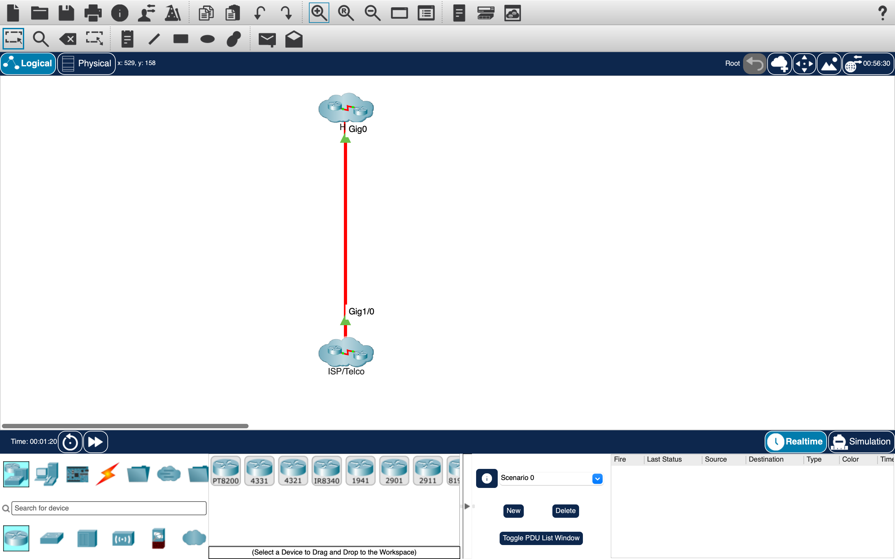
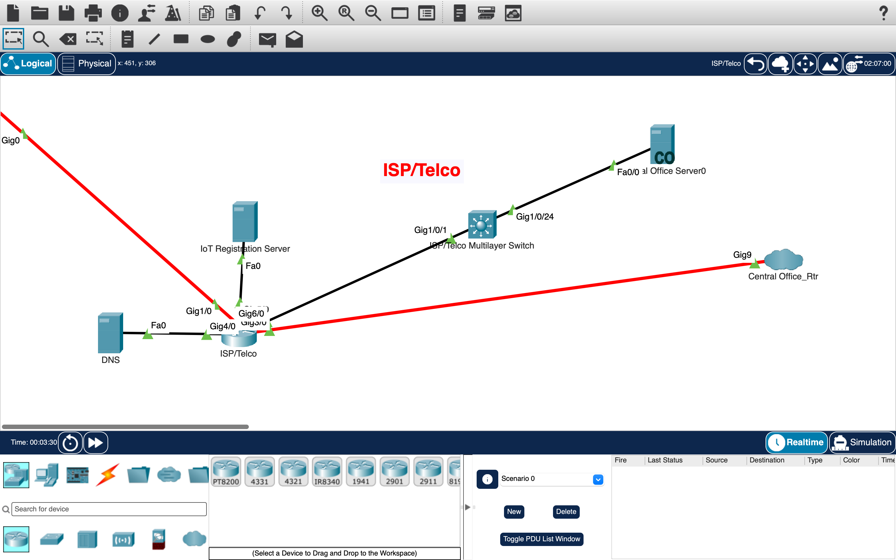
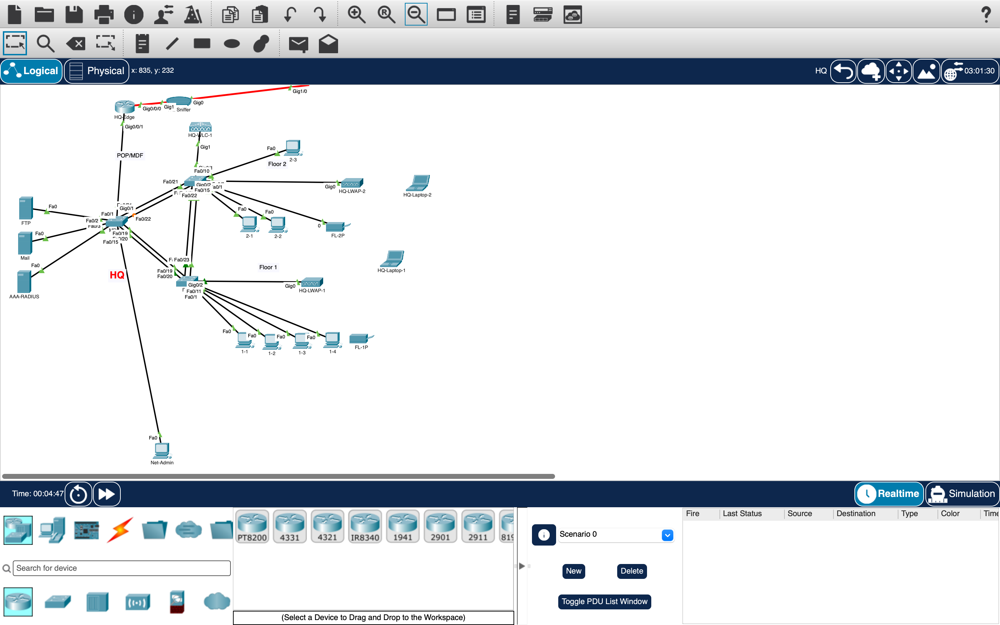
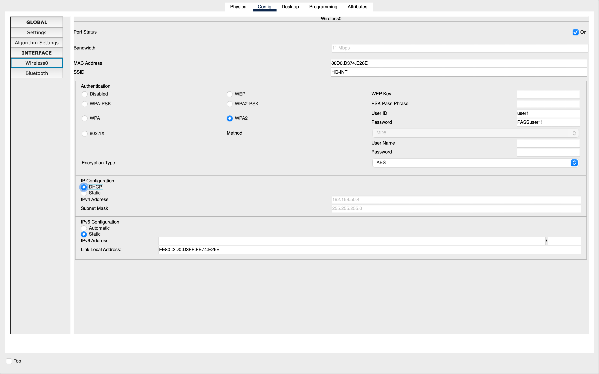
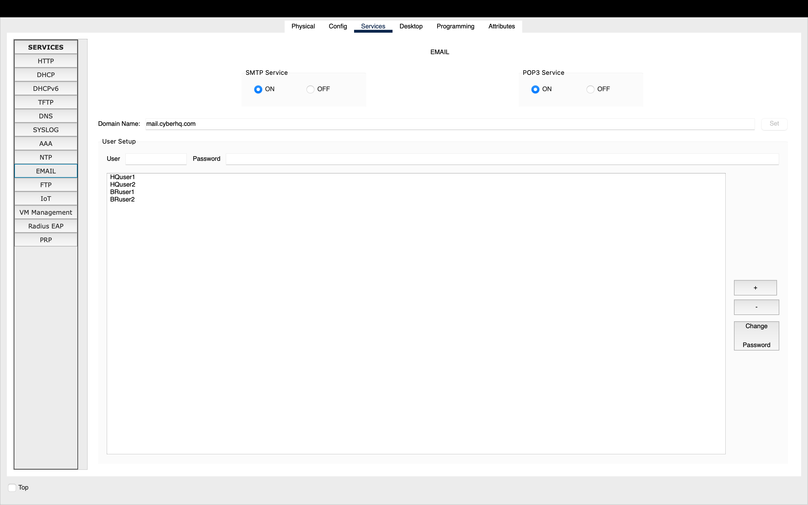
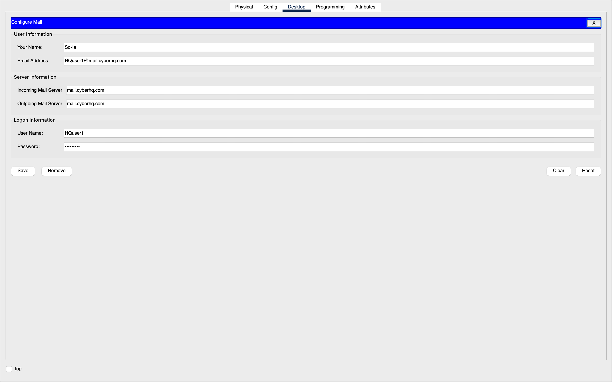
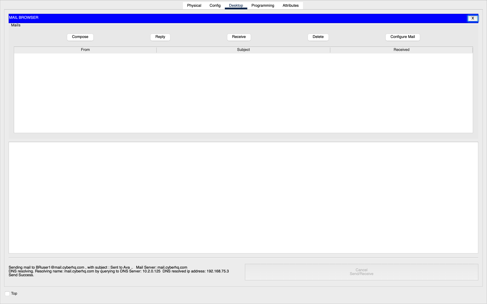
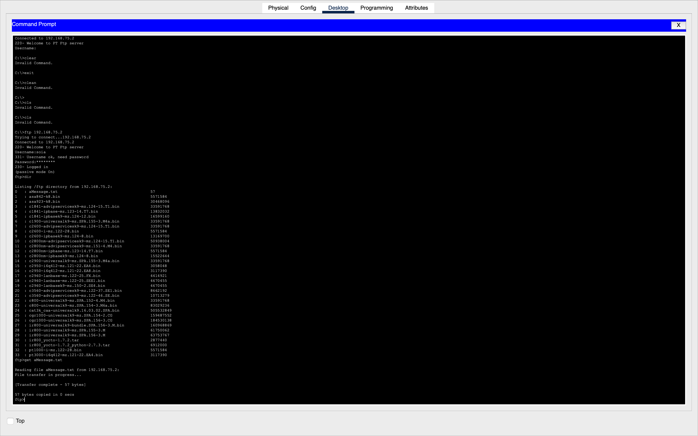

# Implementing AAA Authentication and Network Services

## Project Overview
This project demonstrates the configuration and implementation of AAA authentication for network services using Cisco Packet Tracer. 
The lab focuses on implementing AAA (Authentication, Authorization, and Accounting) for network services including wireless network services, email, and file transfer services to understand how network devices and servers manage secure access and communication.

## Objectives
- Configure and implement AAA authentication credentials.
- Configure and test email services.
- Configure and test FTP services.

## Tools and Technologies
- Cisco Packet Tracer
- Cisco Networking Devices (Routers and Switches)
- AAA Authentication
- Email Services (SMTP/POP3)
- FTP Services
- TCP/IP Networking

## Network Topology

## Email User Accounts
| PC/Laptop | Name | Email Address | Username | Password |
|-----------|------|---------------|-----------|----------|
| 1-1 | Soia | HQuser1@mail.cyberhq.com | HQuser1 | Cisco123! |
| Net-Admin | Cisco | HQuser2@mail.cyberhq.com | HQuser2 | Cisco123~ |
| 2-1 | Ava | BRuser1@mail.cyberhq.com | BRuser1 | Cisco123- |
| HQ-Laptop-1 | Mia | BRuser2@mail.cyberhq.com | BRuser2 | Cisco123+ |

## FTP User Accounts
| Username | Password | User Privilege |
|----------|----------|----------------|
| soia | cisco123 | RWDNL (Read, Write, Delete, Rename, List) |
| ava | cisco321 | RWDNL (Read, Write, Delete, Rename, List) |
| mia | cisco123 | RWNL (Read, Write, Rename, List) |
## Project Implementation

### Configure and Use AAA Authentication Credentials
- Configure user accounts on the AAA-RADIUS server.

- Configure wireless authentication on HQ-Laptop-1.

- Configure wireless authentication on HQ-Laptop-2.

### Configure and Use Email Services
- Activate email services and configure email user accounts.

- Configure email clients.

- Send an email as So-Ia.

### Configure and Use FTP Services
- Activate the FTP service.

- Create the FTP user accounts.

- Transfer files between Net-Admin and the FTP server. Use the get command to download aMessage.txt.

- Open the downloaded file aMessage.txt.

- Log back in to the FTP server as user soia.
Use the put command to upload aMessage_new.txt.

- Verify FTP user privileges are working as configured. Login to the FTP server at 192.168.75.2 with username mia and password cisco123.

## Key Learnings
- Understanding AAA authentication and access control.
- Configuring network services in Cisco Packet Tracer.
- Understanding SMTP, POP3, and FTP protocols.
- Testing and troubleshooting network services.
- Improving practical networking and infrastructure skills.
  
